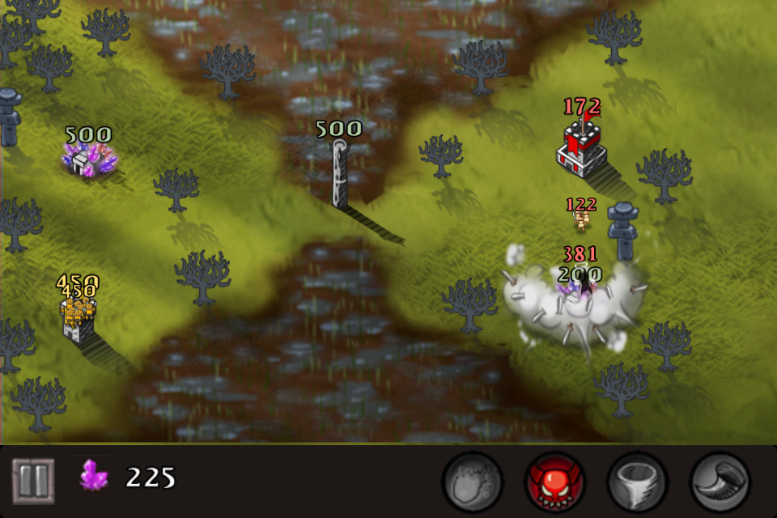
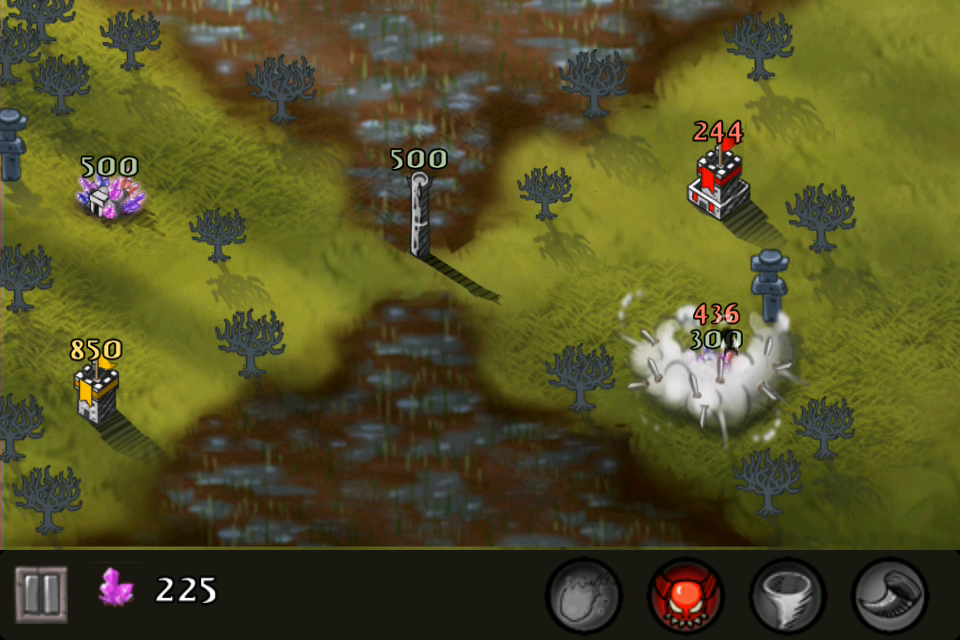
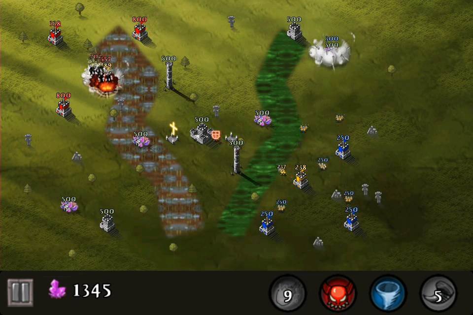
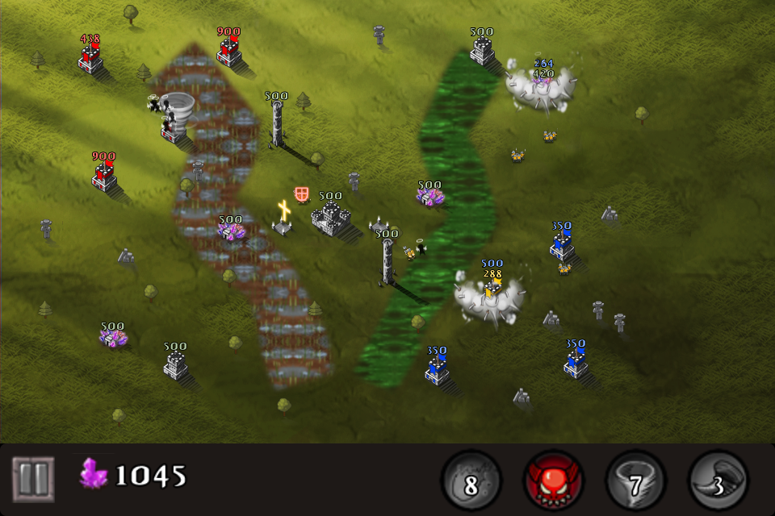

# Castle Wars Rebuilt

A single-player Android strategy game about capturing castles, moving armies and choosing when to spend crystals on spells. Lead the red army against blue and yellow rivals through **90 sequential stages** across three campaigns.

**Current version: 0.16 · Android 6.0+ · Landscape**



## The game

Every castle is a foothold. Send half its garrison to capture a neutral building, reinforce an ally or raid an enemy. Combine several armies for a stronger assault, or redirect a moving group when the battlefield changes.

Castles recruit troops, crystal mines fund spells, and archer towers shoot at passing enemies. Swamps slow armies; poison drains their strength. Angel and shield altars give temporary protection, making the route to a target as important as the size of the army.

- **Three rival armies:** team-colored buildings, flags and combat counts make the front line readable.
- **Animated battles:** troop formations scale with army strength; sieges resolve gradually with clouds, arrows and casualty effects.
- **Four spells:** bombard an area, create a tornado, disrupt enemy movement or summon reinforcements.
- **Persistent progression:** clear stages in order, replay completed missions and buy upgrades through five tiers.
- **Music and effects:** battle tracks, spell sounds and combat audio follow the action.

## Gameplay videos

Click a preview to open its MP4 recording. Both clips are **18-second silent emulator captures**; the spell showcase uses a scripted crystal budget and upgraded reinforcement to demonstrate the effects.

| Deployment and building combat | Spell showcase |
| --- | --- |
| [](docs/media/videos/deployment-and-combat.mp4) | [](docs/media/videos/spell-showcase.mp4) |
| [Watch MP4](docs/media/videos/deployment-and-combat.mp4) · Send waves into a contested building. | [Watch MP4](docs/media/videos/spell-showcase.mp4) · Reinforcement, meteor impacts and tornado damage. |

## Three campaigns

| Campaign | Stages | What changes |
| --- | --- | --- |
| **Original** | 1–30 | Learn deployment, buildings and terrain. Enemy nations use troop tactics without casting spells. |
| **Frontier** | 31–60 | New layouts and curved hazard regions introduce enemy spell casting. |
| **Wild** | 61–90 | New terrain shapes, more demanding routes and stronger enemy spell effects. |




## How to play

1. Select a friendly castle and drag to another castle to send **50%** of its troops. Select several castles to deploy them together.
2. Capture neutral buildings and secure crystal income before committing to a long siege.
3. Redirect moving armies to another castle when you need to defend or change the attack.
4. Watch the terrain: swamp slows movement, while poison punishes time spent inside it.
5. Choose a spell, read its tooltip and select a target. Friendly reinforcements can enter an allied castle under attack; besieged castles cannot deploy troops.

| Spell | Use |
| --- | --- |
| **Meteor** | Fireballs damage enemies in an area, including nearby moving troops. |
| **Tornado** | A moving damage effect remains active for a limited duration. |
| **Mutiny** | Temporarily disrupts enemy troop movement. |
| **Reinforce** | Groups appear around the chosen castle, then march inward to reinforce or invade it. |

## Build and development

The project uses Java and Android Canvas. With a JDK, Android platform 33 and build-tools 33.0.1 installed:

```sh
./build.sh
```

The APK is written to `build/Castle-Wars-Rebuilt.apk`. See the [development guide](docs/development.md) for SDK configuration, signing, tests and terrain authoring.

## OOP and architecture

The game uses a platform-free domain model, immutable stage definitions and an audio interface backed by an Android adapter. `Main` composes the objects; `Board` handles presentation and input; game rules stay in `Engine` and its match objects. Explanatory source comments are kept to one or two lines.

- [Architecture and object responsibilities](docs/architecture.md)
- [Current code map](docs/code-map.md)
- [Media capture notes](docs/media/README.md)

To run the domain and asset checks:

```sh
./tests/run-checks.sh
```
