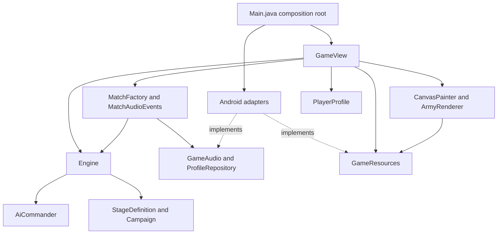

# OOP and architecture

The implementation uses object ownership and explicit dependencies to separate game rules from Android services. `Main.java` is the composition root: it creates adapters, injects them into `GameView` and forwards Android lifecycle events. It contains no rendering, save migration or gameplay rules.

## What Clean Architecture means

Clean Architecture protects application policies from UI, storage and framework details. Its central rule is that source dependencies point inward: domain rules do not name Android services, and outer adapters implement interfaces owned by the code that needs them. The circles are schematic; neither a fixed number of layers nor particular directory names is required. See [Robert C. Martin's original explanation](https://blog.cleancoder.com/uncle-bob/2012/08/13/the-clean-architecture.html).

OOP is a separate concern: objects combine state and behavior, with encapsulation controlling changes. `PlayerProfile` demonstrates that through purchase and progression methods. A folder or a Java class alone establishes neither encapsulation nor architectural independence.

## Why these folders exist

| Location | Reason for grouping | Boundary or limitation |
| --- | --- | --- |
| `Main.java` | One place to construct and connect the Android application. Its visible location also follows the requested entry-point layout. | A composition root must know concrete adapters; being outside the folders is a navigation choice. |
| `domain/` | Rules that define a match and progression should be testable without Android. | This is the core policy boundary; it should not import the application, view or infrastructure. |
| `application/` | Match creation and event delivery coordinate domain objects. Ports describe required save/audio capabilities; this is why the interfaces live beside their consumers rather than beside Android implementations. | These operations know domain types, while Android implementations depend on their interfaces. |
| `presentation/` | Touch, screens, fonts, formations and Canvas drawing change together with the interface. | Android graphics types are acceptable here, but do not belong in domain contracts. |
| `infrastructure/android/` | Preferences, asset decoding and media playback require Android APIs. | The extra `android/` segment groups platform implementations; no additional platform folder is needed until one exists. |
| `domain/stages/` | Campaign policy and stage parsing share one feature area. | This is feature organization inside the domain, not another architectural layer. |
| `domain/stages/data/` | `Original`, `Frontier` and `Wilds` are authored tables with the same role, consumed by the stage catalog. | These are compiled content records, not repositories or gameplay services. Individual campaign folders added unnecessary depth. If stages become external files, their loader belongs in infrastructure while validated definitions stay in the core. |

`data/` here specifically means stage tables. JSON, images and sounds remain under `assets/`, because Android packages and loads those files as resources. Folder depth follows a distinct responsibility; it does not imply a stronger architecture.

## Review of the current code

The current implementation is a **layered OOP design with partial Clean Architecture boundaries**. Calling it a fully isolated Clean Architecture implementation would overstate what the code enforces.

| Finding | Evidence | Assessment |
| --- | --- | --- |
| Rules run without Android. | `Engine`, `AiCommander`, `PlayerProfile` and the application classes compile in the JDK-only check suite. | A useful, verified independence boundary. |
| Platform details are replaceable behind interfaces. | `AndroidProfileRepository`, `AndroidGameAudio` and `AndroidGameResources` implement injected contracts. | Dependency inversion exists at save, audio and resource access boundaries. |
| The view still owns application orchestration. | `GameView.recordVictory()` guards rewards and saves; upgrade handlers purchase and persist directly; `onDraw()` advances simulation. | Progression/save transactions and match scheduling are not fully separated into use cases/controllers. |
| The domain still includes presentation details. | `Engine.spellDetails()` formats tooltip text; `soldierCount()` defines visual density; audio cues name effects such as `fireball` and `twister`. | Platform-free code can still mix responsibilities. A stricter design would expose spell values and semantic events for outer presenters/adapters to format or map. |
| Audio and rendering use the mutable match aggregate. | `GameAudio.update()` takes `Engine` plus UI playback flags; renderers read `Engine.Fort` and other match objects. | These contracts work here but couple adapters to internal match structure; output snapshots/events would narrow them. |
| Some domain-folder types serve presentation. | `WorldLayout` and `MapMarker` describe visual placement; `CampaignInfo.title()` formats headings. | Their folder location is pragmatic grouping, not evidence that they are gameplay policy. A stricter separation would place these presentation values/helpers outside the domain. |
| Folder separation is not compiler isolation. | All Java files declare `package castle`; the checks inspect selected names and imports with regular expressions, plus expected file locations. | Package-private access remains shared. Checks catch known leaks, not every possible dependency. Separate packages/modules or a dependency analyzer would enforce stronger boundaries. |

The next meaningful architecture improvements would be application use cases for rewards/purchases and persistence, tooltip formatting outside `Engine`, semantic sound events, and compiler-enforced dependency boundaries. They require code changes and behavior checks; moving files alone does not accomplish them. This review documents those gaps without changing gameplay.

## Source layout

```text
src/castle/
  Main.java                    Android executable entry point
  domain/                      Match state, AI, profile and immutable layout values
    stages/                    Shared campaign policies and stage parsing
      data/                    Original.java, Frontier.java and Wilds.java
  application/                 Match creation, event delivery and platform-free ports
  presentation/                Input, screens, Canvas primitives and army rendering
  infrastructure/android/      Asset decoding, preferences, audio and terrain baking
```

`build.sh` remains at the repository root. Supporting classes share the `castle` Java package to preserve package-private APIs. The folders express responsibilities; they are not separate Java modules. Automated dependency checks enforce the main boundaries without expanding internal types into public APIs.

## Dependency direction



Domain and application classes compile with the JDK alone. They depend on neither Android nor JSON libraries. `GameResources` is a presentation interface and deliberately exposes Android bitmap types, since Canvas is the rendering technology. Android adapters implement interfaces without retaining the activity or view.

## Object responsibilities

| Object | Owns or decides |
| --- | --- |
| `Engine` | One mutable match: forts, marches, clocks, terrain effects, spells and result state. |
| `Engine.Fight` / `Encounter` | Siege and field-combat state and casualty advancement. |
| `AiCommander` | Enemy target selection, departure thresholds, timing and paid spell decisions; commands its match through existing engine operations. |
| `StageDefinition` | Cached immutable stage data; creates independent mutable entities for each match. |
| `PlayerProfile` | Encapsulated progression, settings, upgrade tiers, purchases and rewards; returns copies of upgrade arrays. |
| `MatchFactory` | Validates stage access and initializes a match with the profile's upgrade effects. |
| `MatchAudioEvents` | Delivers pending cues and raid announcements once, independently of drawing. |
| `ProfileRepository` / `AndroidProfileRepository` | Save contract and Android preference mapping, including legacy save migration. |
| `GameAudio` / `AndroidGameAudio` | Playback contract and Android sample loading, music, effect ownership and lifecycle. |
| `GameResources` / `AndroidGameResources` | Presentation resource contract and JSON/bitmap decoding, caching and validation. |
| `WorldLayout` / `MapMarker` | Typed immutable layout values; scenery collections are copied and unmodifiable. |
| `GameView` | Screen state, selection, touch dispatch, camera and rendering coordination. |
| `CanvasPainter` | Shared image, sprite, font and panel drawing primitives. |
| `ArmyRenderer` | Building/flag anchors, formations, buffs, combat clouds and counts; issues no game commands. |

The engine remains a match aggregate rather than one class per timer or effect. `GameView` still coordinates screens and input; it no longer parses assets, opens preferences, normalizes upgrades or constructs upgraded matches. This is a lightweight layered architecture within one Android application.

## Commands, events and saves

1. `GameView` translates touch coordinates into a selection or an engine command.
2. `Engine` validates commands and advances match clocks; `AiCommander` uses the same deployment and spell operations as the simulation.
3. `MatchAudioEvents` consumes pending audio cues before rendering. A shared raid token prevents staggered groups from repeating the battle-start sound; friendly reinforcement stays silent.
4. `ArmyRenderer` and `CanvasPainter` draw current values. Drawing cannot consume the audio queue.
5. Progression and purchases go through `PlayerProfile`, then the repository saves the updated profile.

The save adapter retains the `original-campaign` preference file, existing key names and the legacy `five-upgrades` migration. Excess tiers are refunded during restoration; saving normalized levels and clearing the migration marker prevents a second refund. `GameView` retains its per-match reward guard so a victory awards points only once.

## Stage and asset ownership

Every campaign uses `terrain/<campaign>/worlds.json` for battlefield dimensions, overlay placement and scenery, alongside `manifest.json` for geometry fingerprints. `map/campaigns.json` contains navigation markers. The root asset manifest links these resources and atlas/font metadata. `AndroidGameResources` parses them into typed layouts; presentation does not interpret JSON.

## Comment policy

Each explanatory source comment is **one or two lines**. Explain ownership, invariants or a reason that names alone cannot convey. Longer explanations belong in these documents. Avoid comments that merely restate a method name.

```java
// Replays earn points, but only the next uncleared stage advances progression.
```

```java
// Terrain bitmaps are disposable between stages; shared atlases stay cached.
```

## Validation

`architecture_check.py` checks platform-free domain/application classes, independent adapters, the thin entry point, presentation boundaries and one/two-line comments recursively. `ApplicationCheck` covers profile encapsulation, progression, refunds, match initialization, immutable layouts and event delivery. `ProfileUiCheck` checks real Android preference migration and save round trips.

The simulation, terrain, campaign, rendering, raid and audio checks retain their existing gameplay expectations. A before/after snapshot comparison covers initial state and 500 simulation ticks in all 90 stages. Documentation capture fixtures remain in the test APK and do not alter shipped game rules.
