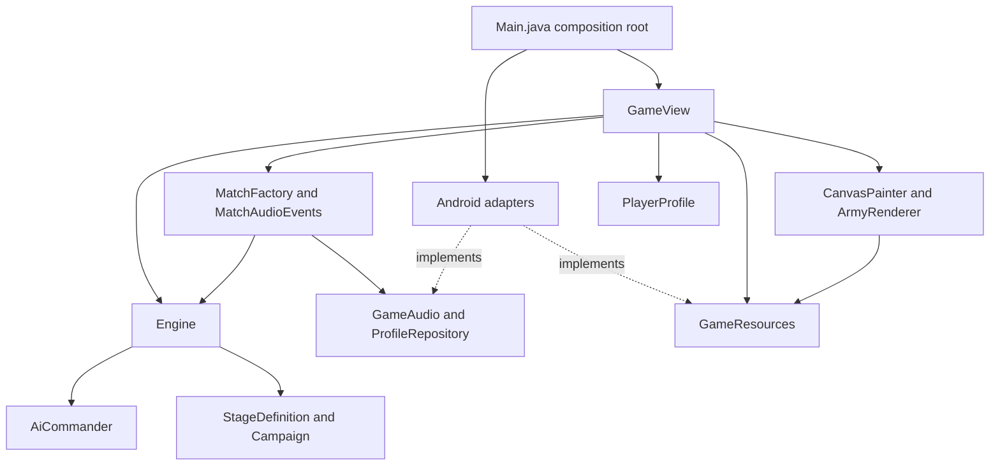

# OOP and architecture

The implementation uses object ownership and explicit dependencies to separate game rules from Android services. `Main.java` is the composition root: it creates adapters, injects them into `GameView` and forwards Android lifecycle events. It contains no rendering, save migration or gameplay rules.

## Source layout

```text
src/castle/
  Main.java                    Android executable entry point
  domain/                      Match state, AI, profile and immutable layout values
    stages/                    Shared campaign policies and stage parsing
      data/                    Original.java, Frontier.java and Wilds.java
  application/                 Match creation, event delivery and platform-free ports
  presentation/                Input, screens, Canvas primitives and army rendering
  infrastructure/android/      Asset decoding, preferences, audio and terrain baking
```

`build.sh` remains at the repository root. Supporting classes share the `castle` Java package to preserve package-private APIs. The folders express responsibilities; they are not separate Java modules. Automated dependency checks enforce the main boundaries without expanding internal types into public APIs.

## Dependency direction



Domain and application classes compile with the JDK alone. They depend on neither Android nor JSON libraries. `GameResources` is a presentation interface and deliberately exposes Android bitmap types, since Canvas is the rendering technology. Android adapters implement interfaces without retaining the activity or view.

## Object responsibilities

| Object | Owns or decides |
| --- | --- |
| `Engine` | One mutable match: forts, marches, clocks, terrain effects, spells and result state. |
| `Engine.Fight` / `Encounter` | Siege and field-combat state and casualty advancement. |
| `AiCommander` | Enemy target selection, departure thresholds, timing and paid spell decisions; commands its match through existing engine operations. |
| `StageDefinition` | Cached immutable stage data; creates independent mutable entities for each match. |
| `PlayerProfile` | Encapsulated progression, settings, upgrade tiers, purchases and rewards; returns copies of upgrade arrays. |
| `MatchFactory` | Validates stage access and initializes a match with the profile's upgrade effects. |
| `MatchAudioEvents` | Delivers pending cues and raid announcements once, independently of drawing. |
| `ProfileRepository` / `AndroidProfileRepository` | Save contract and Android preference mapping, including legacy save migration. |
| `GameAudio` / `AndroidGameAudio` | Playback contract and Android sample loading, music, effect ownership and lifecycle. |
| `GameResources` / `AndroidGameResources` | Presentation resource contract and JSON/bitmap decoding, caching and validation. |
| `WorldLayout` / `MapMarker` | Typed immutable layout values; scenery collections are copied and unmodifiable. |
| `GameView` | Screen state, selection, touch dispatch, camera and rendering coordination. |
| `CanvasPainter` | Shared image, sprite, font and panel drawing primitives. |
| `ArmyRenderer` | Building/flag anchors, formations, buffs, combat clouds and counts; issues no game commands. |

The engine remains a match aggregate rather than one class per timer or effect. `GameView` still coordinates screens and input; it no longer parses assets, opens preferences, normalizes upgrades or constructs upgraded matches. This is a lightweight layered architecture within one Android application.

## Commands, events and saves

1. `GameView` translates touch coordinates into a selection or an engine command.
2. `Engine` validates commands and advances match clocks; `AiCommander` uses the same deployment and spell operations as the simulation.
3. `MatchAudioEvents` consumes pending audio cues before rendering. A shared raid token prevents staggered groups from repeating the battle-start sound; friendly reinforcement stays silent.
4. `ArmyRenderer` and `CanvasPainter` draw current values. Drawing cannot consume the audio queue.
5. Progression and purchases go through `PlayerProfile`, then the repository saves the updated profile.

The save adapter retains the `original-campaign` preference file, existing key names and the legacy `five-upgrades` migration. Excess tiers are refunded during restoration; saving normalized levels and clearing the migration marker prevents a second refund. `GameView` retains its per-match reward guard so a victory awards points only once.

## Stage and asset ownership

Every campaign uses `terrain/<campaign>/worlds.json` for battlefield dimensions, overlay placement and scenery, alongside `manifest.json` for geometry fingerprints. `map/campaigns.json` contains navigation markers. The root asset manifest links these resources and atlas/font metadata. `AndroidGameResources` parses them into typed layouts; presentation does not interpret JSON.

## Comment policy

Each explanatory source comment is **one or two lines**. Explain ownership, invariants or a reason that names alone cannot convey. Longer explanations belong in these documents. Avoid comments that merely restate a method name.

```java
// Replays earn points, but only the next uncleared stage advances progression.
```

```java
// Terrain bitmaps are disposable between stages; shared atlases stay cached.
```

## Validation

`architecture_check.py` checks platform-free domain/application classes, independent adapters, the thin entry point, presentation boundaries and one/two-line comments recursively. `ApplicationCheck` covers profile encapsulation, progression, refunds, match initialization, immutable layouts and event delivery. `ProfileUiCheck` checks real Android preference migration and save round trips.

The simulation, terrain, campaign, rendering, raid and audio checks retain their existing gameplay expectations. A before/after snapshot comparison covers initial state and 500 simulation ticks in all 90 stages. Documentation capture fixtures remain in the test APK and do not alter shipped game rules.
