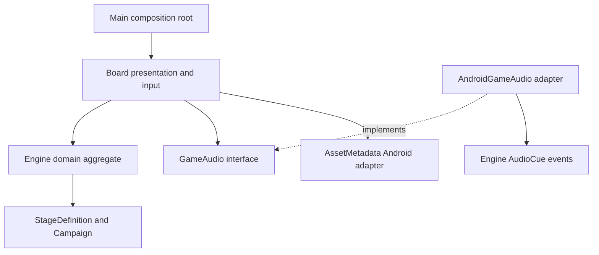

# OOP and architecture

Castle Wars Rebuilt uses a lightweight layered design: the match rules and stage definitions form the domain, the Android activity coordinates presentation, and platform adapters own asset access and media playback. The layers share the `castle` package, keeping the public API small through package-private types.

## Dependency direction



`GameAudio` contains no Android types. `Main.onCreate` constructs `AndroidGameAudio` and stores it behind that interface. The adapter receives explicit match and playback state; it has no reference to `Main` or `Board`. Domain code compiles with the JDK without Android libraries.

## Object responsibilities

| Object | Responsibility and ownership |
| --- | --- |
| `Engine` | Owns one match: forts, marches, encounters, clocks, spell effects, AI and result state. |
| `Engine.Fort` | Holds a building's garrison, recruitment state and optional siege. |
| `Engine.March` | Carries an army's strength, origin type, destination, buffs and raid identity. |
| `Engine.Fight` | Resolves a siege using all active teams and pre-tick troop strengths. |
| `Engine.Encounter` | Holds opposing armies at a shared field location and resolves their casualties. |
| `Engine.Marsh` | Represents a slow or poison polygon and its independent effect clock. |
| `StageDefinition` | Caches immutable stage data and creates independent mutable objects for each match. |
| `Campaign` | Defines campaign boundaries, navigation IDs and enemy spell policy. |
| `GameAudio` | Provides the application-facing contract for effects, music and audio lifecycle. |
| `AndroidGameAudio` | Owns SoundPool samples, MediaPlayer music, pending requests and effect streams. |
| `AssetMetadata` | Reads versioned JSON metadata and validates sprite and font rectangles. |
| `Main.Board` | Converts touch input to commands and draws the current state on Android Canvas. |

State and behavior live together at the match level: `Engine` coordinates its domain objects, while `Fight` and `Encounter` own combat advancement. Presentation and touch coordination currently share the `Board` class. Platform playback has its own adapter, making its lifecycle independently understandable and testable.

## A command through the system

1. `Board` converts a screen position into a castle or moving army selection.
2. A domain command validates the action and updates the match. Sending troops, joining a raid and applying arrival caps are decided in `Engine`.
3. Match clocks advance movement, recruitment, terrain effects, spells and combat.
4. The engine emits platform-free `AudioCue` events. `Board` forwards them through `GameAudio`.
5. `AndroidGameAudio` waits for sample loading, starts or stops owned effect streams, and applies pause/resume state.
6. `Board` renders the updated match, including formations, projectiles, clouds and team-colored counts.

A shared raid token follows a combined army. A siege announces that token once, so staggered survivors do not duplicate battle-start audio. An independent hostile wave can announce itself; friendly reinforcement arrivals stay silent.

## Stage and asset ownership

Each campaign has the same terrain file pair:

- `terrain/<campaign>/worlds.json` contains battlefield dimensions, overlay placements and scenery.
- `terrain/<campaign>/manifest.json` contains the established overlay-fingerprint format.

`map/campaigns.json` contains navigation markers. The root asset manifest links these files and the sprite/font metadata. This keeps battlefield data separate from campaign navigation and lets terrain generators update one campaign without rewriting the others.

## Comment policy

Keep each explanatory source comment to **one or two lines**. Explain an ownership rule, invariant or reason for a decision; let the type and method names describe ordinary steps. Longer explanations belong here or in the code map.

Examples used in the implementation:

```java
// Queue unloaded samples so the first spell cannot lose its launch sound.
```

```java
// Effect ownership keeps one tornado loop alive and stops it with its spell.
```

## Validation

`tests/architecture_check.py` enforces domain independence, the audio adapter boundary and one/two-line source comments. `tests/run-checks.sh` compiles the platform-free classes with the JDK and checks gameplay, stage isolation, terrain data, raid grouping and audio events. Android instrumentation verifies actual sample loading, stream ownership, pause/resume and campaign navigation.

`ShowcaseUiCheck` is a documentation capture fixture. It lives in the instrumentation APK, records the running game and decodes video frames for inspection. Its temporary progress and spell-demo settings do not change shipped game rules or saved player progression.
